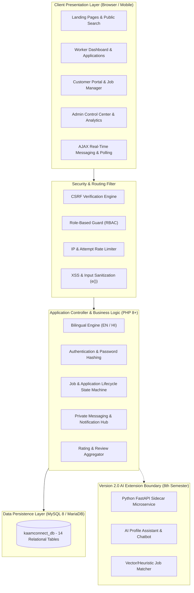
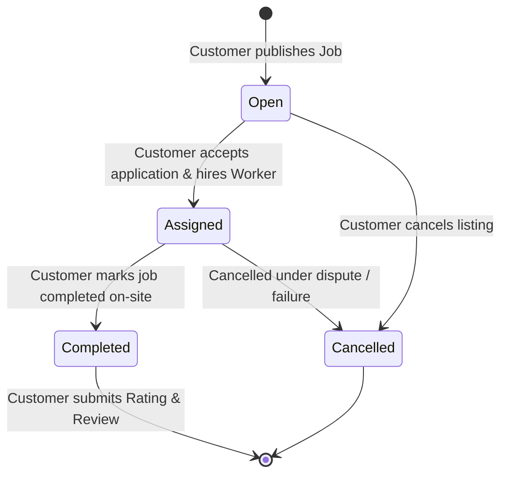

# KaamConnect: System Architecture & Technical Specification

## 1. Project Overview & Design Philosophy

**KaamConnect** is a localized employment and artisan hiring marketplace created as a B.Tech Computer Science & Engineering Major Project. The platform bridges the communication, discovery, and verification gap between informal sector workers (plumbers, electricians, painters, carpenters, cleaners, masons, mechanics) and nearby residential/commercial customers.

The system is developed with strict adherence to high-performance, lightweight, and dependency-minimal full-stack web engineering:
- **Presentation Layer**: HTML5, CSS3, JavaScript (ES6+), Bootstrap 5.3, Font Awesome 6.
- **Application Backend**: PHP 8.2+ utilizing PDO (PHP Data Objects) with persistent connections and strict type definitions (`declare(strict_types=1);`).
- **Data Persistence**: MySQL / MariaDB (InnoDB engine, `utf8mb4_unicode_ci`).
- **Target Execution**: Local development via XAMPP / Apache on Windows 10/11.

---

## 2. Multi-Tier System Architecture

---

## 3. Core Component Subsystems

### 3.1 Role-Based Access Control (RBAC)
KaamConnect defines three non-overlapping user roles stored in `users.role`:
1. **Worker (`worker`)**: Authorized to manage worker profile, showcase portfolios, search jobs, apply, negotiate, and chat with customers.
2. **Customer (`customer`)**: Authorized to post jobs, review applications, assign workers, oversee completion, issue ratings, and chat.
3. **Administrator (`admin`)**: Superuser authorized to verify workers, suspend abusive users, manage trades/categories, review platform reports, and view analytics.

Public routes (login, register, search, landing page) are open. Authenticated routes are protected via `requireRole('worker')`, `requireRole('customer')`, or `requireRole('admin')`.

### 3.2 Job Lifecycle State Machine
Jobs advance strictly through deterministic state transitions:

**Application States**:
- `pending`: Worker applied, waiting customer review.
- `accepted`: Customer hired this applicant (auto-rejects other pending bids).
- `rejected`: Customer declined this applicant.
- `withdrawn`: Worker pulled back application before decision.

### 3.3 Private Messaging Engine
- **One-to-One Conversations**: Grouped by Customer ID, Worker ID, and optional Job ID.
- **Asynchronous AJAX Polling**: Client polls `api/messages.php?action=fetch&conversation_id=X` every 3 seconds for incremental messages (`last_msg_id > Y`).
- **Zero Framework Bloat**: Clean vanilla JavaScript `fetch()` API with JSON payload delivery.
- **Authorization Enforcement**: Every message access validates that `session.user.id` is strictly the sender or receiver in the parent conversation.

### 3.4 Bilingual Localization (EN / HI)
- Language preference stored in session (`$_SESSION['lang']`) and persisted to `users.preferred_language`.
- Zero database query latency for UI text: translations are stored in native PHP arrays in `includes/languages/en.php` and `includes/languages/hi.php`.
- Instant toggle via navbar language selector (`?lang=en` or `?lang=hi`).

---

## 4. Security Architecture

1. **Password Security**: Uses PHP `password_hash($pass, PASSWORD_BCRYPT)` and `password_verify()`.
2. **SQL Injection Defense**: 100% prepared statements via PHP PDO with emulated prepares disabled (`PDO::ATTR_EMULATE_PREPARES => false`).
3. **Cross-Site Scripting (XSS)**: Strict contextual escaping helper `e()` (`htmlspecialchars(..., ENT_QUOTES | ENT_SUBSTITUTE, 'UTF-8')`).
4. **Cross-Site Request Forgery (CSRF)**: Cryptographic 32-byte hexadecimal token bound to user session and verified on all state-changing POST/PUT/DELETE requests.
5. **Rate Limiting**: Failed authentication attempts tracked in `login_attempts` with automatic 15-minute lockouts after 5 consecutive failures per IP/identifier.
6. **File Upload Hardening**:
   - File extension verified against actual MIME type using PHP `finfo`.
   - Only `image/jpeg`, `image/png`, and `image/webp` permitted.
   - Max file size bounded to 3MB.
   - File renamed using random 16-character hexadecimal token to prevent directory traversal and overwrite attacks.

---

## 5. Future AI Extension (Version 2.0 - 8th Semester)

The software architecture is decoupled so that future intelligent services can be attached via RESTful endpoints without modifying core marketplace transactions:
- **Microservice Protocol**: Python FastAPI service running on port 8000.
- **AI Chat Assistant**: Natural language bot to assist non-tech-savvy workers with verbal guidance in Hindi and English.
- **Smart Job Recommendation**: Matrix factorization / cosine similarity between worker skill vectors and job requirements.
- **AI Profile Enhancer**: Generates well-crafted professional summaries from simple voice/text bullet points.
