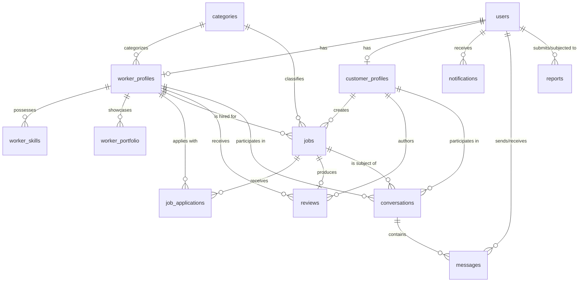

# KaamConnect: Database Schema & Entity-Relationship Model

## 1. Relational Database Overview

- **Database Name**: `kaamconnect_db`
- **Database Engine**: MySQL 8.0+ / MariaDB 10.3+ (InnoDB)
- **Character Encoding**: `utf8mb4`
- **Collation**: `utf8mb4_unicode_ci` (Full Unicode support for multilingual Hindi Devanagari text, names, and emojis)

---

## 2. Entity-Relationship (ER) Diagram

---

## 3. Data Dictionary (All 14 Tables)

### 3.1 `users`
| Field | Type | Nullable | Key | Default | Description |
|---|---|---|---|---|---|
| `id` | INT AUTO_INCREMENT | No | PK | - | Unique user identifier |
| `full_name` | VARCHAR(100) | No | - | - | User legal/display name |
| `email` | VARCHAR(150) | Yes | UNI | NULL | User email address |
| `phone` | VARCHAR(20) | No | UNI | - | Primary phone / mobile number |
| `password_hash` | VARCHAR(255) | No | - | - | Bcrypt hashed password |
| `role` | ENUM('worker','customer','admin') | No | IDX | - | Access authorization role |
| `preferred_language` | ENUM('en','hi') | Yes | - | 'en' | Preferred interface language |
| `status` | ENUM('active','suspended','pending') | Yes | IDX | 'active' | Account moderation status |
| `created_at` | DATETIME | Yes | - | CURRENT_TIMESTAMP | Account registration timestamp |
| `updated_at` | DATETIME | Yes | - | CURRENT_TIMESTAMP | Last modification timestamp |

### 3.2 `categories`
| Field | Type | Nullable | Key | Default | Description |
|---|---|---|---|---|---|
| `id` | INT AUTO_INCREMENT | No | PK | - | Trade category ID |
| `name_en` | VARCHAR(100) | No | UNI | - | Category title in English |
| `name_hi` | VARCHAR(100) | No | - | - | Category title in Hindi (Devanagari) |
| `icon` | VARCHAR(50) | No | - | 'fa-tools' | Font Awesome icon class name |
| `description` | TEXT | Yes | - | NULL | Trade summary and inclusions |
| `is_active` | TINYINT(1) | Yes | - | 1 | Category active status flag |
| `created_at` | DATETIME | Yes | - | CURRENT_TIMESTAMP | Creation timestamp |

### 3.3 `worker_profiles`
| Field | Type | Nullable | Key | Default | Description |
|---|---|---|---|---|---|
| `id` | INT AUTO_INCREMENT | No | PK | - | Worker profile ID |
| `user_id` | INT | No | FK, UNI | - | Linked user ID (`users.id`) |
| `profile_photo` | VARCHAR(255) | Yes | - | 'default-avatar.png' | Relative image path |
| `primary_category_id` | INT | Yes | FK | NULL | Primary trade category ID |
| `experience_years` | INT | Yes | - | 0 | Total industry experience in years |
| `daily_wage` | DECIMAL(10,2) | Yes | - | 0.00 | Standard daily wage expectation |
| `hourly_wage` | DECIMAL(10,2) | Yes | - | 0.00 | Standard hourly wage expectation |
| `wage_type` | ENUM('daily','hourly','negotiable') | Yes | - | 'daily' | Wage billing preference |
| `bio` | TEXT | Yes | - | NULL | Worker professional introduction |
| `city` | VARCHAR(100) | No | IDX | - | Operational city |
| `locality` | VARCHAR(150) | No | IDX | - | Operational neighbourhood / colony |
| `address` | TEXT | Yes | - | NULL | Full physical address |
| `is_available` | TINYINT(1) | Yes | IDX | 1 | Immediate availability toggle |
| `is_verified` | TINYINT(1) | Yes | IDX | 0 | Admin background verification flag |
| `verification_notes` | TEXT | Yes | - | NULL | Admin verification remarks |
| `rating_avg` | DECIMAL(3,2) | Yes | IDX | 0.00 | Cached average star rating (1.00 - 5.00) |
| `rating_count` | INT | Yes | - | 0 | Total number of customer reviews |
| `created_at` | DATETIME | Yes | - | CURRENT_TIMESTAMP | Profile creation timestamp |
| `updated_at` | DATETIME | Yes | - | CURRENT_TIMESTAMP | Profile update timestamp |

### 3.4 `customer_profiles`
| Field | Type | Nullable | Key | Default | Description |
|---|---|---|---|---|---|
| `id` | INT AUTO_INCREMENT | No | PK | - | Customer profile ID |
| `user_id` | INT | No | FK, UNI | - | Linked user ID (`users.id`) |
| `profile_photo` | VARCHAR(255) | Yes | - | 'default-avatar.png' | Profile picture path |
| `city` | VARCHAR(100) | No | IDX | - | Resident city |
| `locality` | VARCHAR(150) | No | IDX | - | Resident colony / locality |
| `address` | TEXT | Yes | - | NULL | House / apartment detailed address |
| `alternative_phone` | VARCHAR(20) | Yes | - | NULL | Secondary contact number |
| `created_at` | DATETIME | Yes | - | CURRENT_TIMESTAMP | Timestamp |
| `updated_at` | DATETIME | Yes | - | CURRENT_TIMESTAMP | Timestamp |

### 3.5 `worker_skills`
| Field | Type | Nullable | Key | Default | Description |
|---|---|---|---|---|---|
| `id` | INT AUTO_INCREMENT | No | PK | - | Skill tag ID |
| `worker_id` | INT | No | FK | - | Linked worker ID (`worker_profiles.id`) |
| `skill_name` | VARCHAR(100) | No | IDX | - | Specific skill tag (e.g. Pipe Threading) |
| `created_at` | DATETIME | Yes | - | CURRENT_TIMESTAMP | Timestamp |

### 3.6 `jobs`
| Field | Type | Nullable | Key | Default | Description |
|---|---|---|---|---|---|
| `id` | INT AUTO_INCREMENT | No | PK | - | Job listing ID |
| `customer_id` | INT | No | FK | - | Owner customer profile ID |
| `category_id` | INT | No | FK | - | Trade category ID |
| `title` | VARCHAR(200) | No | - | - | Job headline |
| `description` | TEXT | No | - | - | Full requirement specifications |
| `required_skills` | VARCHAR(255) | Yes | - | NULL | Desired worker capabilities |
| `city` | VARCHAR(100) | No | IDX | - | Job site city |
| `locality` | VARCHAR(150) | No | IDX | - | Job site colony / sector |
| `budget` | DECIMAL(10,2) | No | - | - | Estimated budget in INR |
| `wage_type` | ENUM('fixed','daily','hourly') | Yes | - | 'fixed' | Budget type |
| `preferred_date` | DATE | No | - | - | Required start date |
| `status` | ENUM('open','assigned','completed','cancelled') | Yes | IDX | 'open' | Lifecycle state |
| `hired_worker_id` | INT | Yes | FK | NULL | Selected worker profile ID |
| `created_at` | DATETIME | Yes | - | CURRENT_TIMESTAMP | Timestamp |
| `updated_at` | DATETIME | Yes | - | CURRENT_TIMESTAMP | Timestamp |

### 3.7 `job_applications`
| Field | Type | Nullable | Key | Default | Description |
|---|---|---|---|---|---|
| `id` | INT AUTO_INCREMENT | No | PK | - | Application ID |
| `job_id` | INT | No | FK, UNI | - | Job ID |
| `worker_id` | INT | No | FK, UNI | - | Worker ID (Composite Unique with job_id) |
| `proposed_wage` | DECIMAL(10,2) | No | - | - | Worker's proposed quote (INR) |
| `cover_note` | TEXT | Yes | - | NULL | Proposal message to customer |
| `status` | ENUM('pending','accepted','rejected','withdrawn') | Yes | IDX | 'pending' | Application state |
| `applied_at` | DATETIME | Yes | - | CURRENT_TIMESTAMP | Submission timestamp |
| `updated_at` | DATETIME | Yes | - | CURRENT_TIMESTAMP | Status update timestamp |

### 3.8 `conversations`
| Field | Type | Nullable | Key | Default | Description |
|---|---|---|---|---|---|
| `id` | INT AUTO_INCREMENT | No | PK | - | Conversation channel ID |
| `job_id` | INT | Yes | FK | NULL | Associated job listing |
| `customer_id` | INT | No | FK | - | Participating customer profile |
| `worker_id` | INT | No | FK | - | Participating worker profile |
| `created_at` | DATETIME | Yes | - | CURRENT_TIMESTAMP | Initiation timestamp |
| `updated_at` | DATETIME | Yes | - | CURRENT_TIMESTAMP | Last message timestamp |

### 3.9 `messages`
| Field | Type | Nullable | Key | Default | Description |
|---|---|---|---|---|---|
| `id` | INT AUTO_INCREMENT | No | PK | - | Message ID |
| `conversation_id` | INT | No | FK | - | Parent conversation ID |
| `sender_id` | INT | No | FK | - | User ID of message author |
| `receiver_id` | INT | No | FK | - | User ID of recipient |
| `message_text` | TEXT | No | - | - | Encrypted/sanitized text body |
| `is_read` | TINYINT(1) | Yes | IDX | 0 | Read acknowledgment flag |
| `sent_at` | DATETIME | Yes | - | CURRENT_TIMESTAMP | Message dispatch timestamp |

### 3.10 `reviews`
| Field | Type | Nullable | Key | Default | Description |
|---|---|---|---|---|---|
| `id` | INT AUTO_INCREMENT | No | PK | - | Review ID |
| `job_id` | INT | No | FK, UNI | - | Completed job ID (one review per job) |
| `customer_id` | INT | No | FK | - | Author customer profile |
| `worker_id` | INT | No | FK, IDX | - | Subject worker profile |
| `rating` | TINYINT UNSIGNED | No | - | - | Star rating (1 to 5) |
| `review_text` | TEXT | Yes | - | NULL | Written feedback comment |
| `created_at` | DATETIME | Yes | - | CURRENT_TIMESTAMP | Timestamp |

### 3.11 `notifications`
| Field | Type | Nullable | Key | Default | Description |
|---|---|---|---|---|---|
| `id` | INT AUTO_INCREMENT | No | PK | - | Notification ID |
| `user_id` | INT | No | FK, IDX | - | Recipient user ID |
| `title` | VARCHAR(150) | No | - | - | Notification headline |
| `message` | TEXT | No | - | - | Notification body message |
| `link` | VARCHAR(255) | Yes | - | NULL | Target redirection link |
| `type` | VARCHAR(50) | Yes | - | 'system' | Category event type |
| `is_read` | TINYINT(1) | Yes | IDX | 0 | Read status |
| `created_at` | DATETIME | Yes | - | CURRENT_TIMESTAMP | Creation timestamp |

### 3.12 `worker_portfolio`
| Field | Type | Nullable | Key | Default | Description |
|---|---|---|---|---|---|
| `id` | INT AUTO_INCREMENT | No | PK | - | Portfolio item ID |
| `worker_id` | INT | No | FK, IDX | - | Subject worker profile ID |
| `image_path` | VARCHAR(255) | No | - | - | Relative path to work photograph |
| `title` | VARCHAR(150) | No | - | - | Project/craft title |
| `description` | TEXT | Yes | - | NULL | Details of materials and work done |
| `uploaded_at` | DATETIME | Yes | - | CURRENT_TIMESTAMP | Upload timestamp |

### 3.13 `reports`
| Field | Type | Nullable | Key | Default | Description |
|---|---|---|---|---|---|
| `id` | INT AUTO_INCREMENT | No | PK | - | Incident report ID |
| `reporter_id` | INT | No | FK | - | User ID filing complaint |
| `reported_user_id` | INT | Yes | FK | NULL | User ID accused |
| `job_id` | INT | Yes | FK | NULL | Associated job listing |
| `reason` | VARCHAR(150) | No | - | - | Report classification |
| `details` | TEXT | No | - | - | In-depth description of incident |
| `status` | ENUM('pending','investigating','resolved','dismissed') | Yes | IDX | 'pending' | Moderation status |
| `created_at` | DATETIME | Yes | - | CURRENT_TIMESTAMP | Timestamp |
| `updated_at` | DATETIME | Yes | - | CURRENT_TIMESTAMP | Timestamp |

### 3.14 `login_attempts`
| Field | Type | Nullable | Key | Default | Description |
|---|---|---|---|---|---|
| `id` | INT AUTO_INCREMENT | No | PK | - | Attempt tracking ID |
| `ip_address` | VARCHAR(45) | No | IDX | - | Client IPv4 / IPv6 address |
| `identifier` | VARCHAR(150) | No | IDX | - | Phone or email attempted |
| `is_success` | TINYINT(1) | Yes | - | 0 | Authentication success flag |
| `attempted_at` | DATETIME | Yes | IDX | CURRENT_TIMESTAMP | Timestamp |
